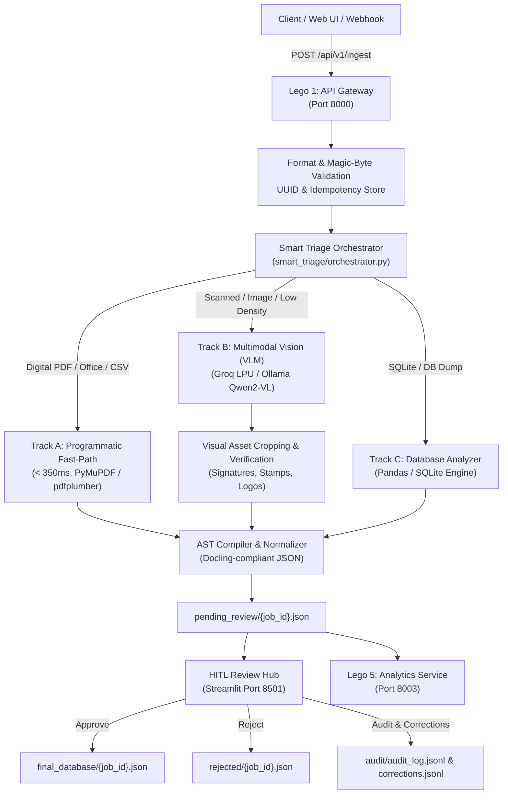

# IDP Architecture & Component Guide

A comprehensive architectural and functional reference for the **Intelligent Document Processing (IDP)** system. This document describes **what** each component does, **how** documents flow through the pipeline, and **where** each process is implemented in the codebase.

---

## 1. System Overview & Architecture

The IDP platform automates enterprise document ingestion, cognitive classification, extraction, validation, human-in-the-loop review, and analytics.

---

## 2. End-to-End Processing Lifecycle

Every document processed by the platform moves through seven distinct phases:

### Phase 1: Ingestion & Validation
* **What it does**: Receives files via HTTP multipart upload, checks MIME types via magic bytes (rejecting spoofed extensions), enforces size limits ($\le 50\text{ MB}$), checks idempotency keys to avoid duplicate work, and creates a unique `job_id` (UUIDv4).
* **Where it is implemented**:
  - Standalone Gateway: [`lego1_gateway/main_standalone.py` (L105–L210, `ingest_document()`)](file:///c:/Users/DARSHAN/OneDrive/Desktop/projects/IDP/lego1_gateway/main_standalone.py#L105-L210)
  - Distributed Gateway: [`lego1_gateway/main.py` (L95–L165, `ingest_document()`)](file:///c:/Users/DARSHAN/OneDrive/Desktop/projects/IDP/lego1_gateway/main.py#L95-L165)
  - Celery Worker Dispatch: [`lego1_gateway/worker.py` (L38–L90, `process_document_task()`)](file:///c:/Users/DARSHAN/OneDrive/Desktop/projects/IDP/lego1_gateway/worker.py#L38-L90)

---

### Phase 2: Cognitive Triage & Routing
* **What it does**: Analyzes the raw file to select the optimal processing track (cost, latency, and quality):
  - **Track A (Fast-Path)**: Born-digital PDFs, Excel spreadsheets, CSVs, and Word docs with extractable digital text (> 100 chars/page). Operates on CPU in ~300 ms with \$0 API cost.
  - **Track B (Multimodal VLM)**: Scanned documents, mobile camera photos, images, and low-density/degraded PDFs. Routes through OpenCV pre-processing and Qwen2-VL vision model via Groq LPU or Ollama.
  - **Track C (Database Analysis)**: Tabular data dumps, SQLite files, and complex data tables requiring ER schema inference.
* **Where it is implemented**:
  - Routing Logic: [`smart_triage/orchestrator.py` (L75–L140, `route_document()`)](file:///c:/Users/DARSHAN/OneDrive/Desktop/projects/IDP/smart_triage/orchestrator.py#L75-L140)
  - Pre-screening Service: [`lego2_triage/triage_service.py` (L45–L120, `triage_file()`)](file:///c:/Users/DARSHAN/OneDrive/Desktop/projects/IDP/lego2_triage/triage_service.py#L45-L120)

---

### Phase 3: Extraction Execution

#### Track A: Programmatic Extraction
* **What it does**: Extract clean hierarchical text, tables, headers, and metadata using PyMuPDF and pdfplumber without calling external LLM APIs.
* **Where it is implemented**:
  - Digital PDF Extraction: [`smart_triage/orchestrator.py` (L145–L220, `_extract_digital_pdf()`)](file:///c:/Users/DARSHAN/OneDrive/Desktop/projects/IDP/smart_triage/orchestrator.py#L145-L220)
  - Tabular & Office Extraction: [`smart_triage/db_analyzer.py` (L40–L110, `analyze_tabular_file()`)](file:///c:/Users/DARSHAN/OneDrive/Desktop/projects/IDP/smart_triage/db_analyzer.py#L40-L110)

#### Track B: Multimodal Vision (VLM)
* **What it does**: Sends document images to Qwen2-VL (via Groq Cloud LPU or Ollama) with a structured schema prompt. The model extracts verbatim text, table matrices, key-value pairs, and bounding boxes for visual objects (signatures, stamps, logos).
* **Where it is implemented**:
  - VLM Engine & Schema Prompt: [`lego3_qwen/qwen_engine.py` (L130–L210, `extract()`)](file:///c:/Users/DARSHAN/OneDrive/Desktop/projects/IDP/lego3_qwen/qwen_engine.py#L130-L210)
  - Direct VLM Call in Standalone Mode: [`lego1_gateway/main_standalone.py` (L750–L810, `_call_qwen_extract()`)](file:///c:/Users/DARSHAN/OneDrive/Desktop/projects/IDP/lego1_gateway/main_standalone.py#L750-L810)

---

### Phase 4: Signature & Visual Asset Pipeline
* **What it does**:
  1. **Bounding Box Crop**: Crops coordinates provided by the VLM for any label matching `"signature"`.
  2. **Biometric & Image Verification**: Evaluates aspect ratio, Canny edge count, ink ratio (5–25%), reject keywords ("terms and conditions"), and maximum word count (< 13 words).
  3. **Heuristic Re-localization**: If the VLM box is inaccurate, scans for anchor labels (`"signature"`, `"authorized"`, `"signed"`) or sweeps bottom horizontal bands.
  4. **Text vs. Image Output**: If clean text is found ($\ge 40\%$ OCR confidence), saves as `signature_text`; otherwise retains verified crop as `signature_image`.
* **Where it is implemented**:
  - Asset Cropping & Orchestration: [`lego1_gateway/main_standalone.py` (L520–L635, `crop_visual_assets()`)](file:///c:/Users/DARSHAN/OneDrive/Desktop/projects/IDP/lego1_gateway/main_standalone.py#L520-L635)
  - Image Verification: [`lego1_gateway/main_standalone.py` (L311–L431, `_verify_signature_image()`)](file:///c:/Users/DARSHAN/OneDrive/Desktop/projects/IDP/lego1_gateway/main_standalone.py#L311-L431)
  - Fallback Relocation: [`lego1_gateway/main_standalone.py` (L433–L505, `_relocate_signature()`)](file:///c:/Users/DARSHAN/OneDrive/Desktop/projects/IDP/lego1_gateway/main_standalone.py#L433-L505)

---

### Phase 5: AST Compilation & Standardization
* **What it does**: Transforms heterogeneous outputs from Track A, Track B, or Track C into a strictly typed, Docling-compliant Abstract Syntax Tree (AST Schema v2.0.0). Computes document-level confidence scores based on element weights.
* **Where it is implemented**:
  - AST Compiler: [`smart_triage/ast_compiler.py` (L50–L320, `compile_ast()`)](file:///c:/Users/DARSHAN/OneDrive/Desktop/projects/IDP/smart_triage/ast_compiler.py#L50-L320)
  - Formal Schema Definition: [`schemas/ast_schema.json`](file:///c:/Users/DARSHAN/OneDrive/Desktop/projects/IDP/schemas/ast_schema.json)
  - Dataframe & Spreadsheet Exporter: [`lego1_gateway/main_standalone.py` (L641–L690, `build_dataframes()`)](file:///c:/Users/DARSHAN/OneDrive/Desktop/projects/IDP/lego1_gateway/main_standalone.py#L641-L690)

---

### Phase 6: Human-in-the-Loop (HITL) Review & Audit
* **What it does**: Presents a dual-pane interface showing the original document with bounding box overlays alongside an interactive AST editor. Operators can edit extracted values, approve jobs to `final_database/`, or reject them to `rejected/`. Operator edits are saved as active learning training pairs in `audit/corrections.jsonl`.
* **Where it is implemented**:
  - Streamlit Review Hub: [`smart_triage/smart_triage_hitl_app.py` (L1–L450)](file:///c:/Users/DARSHAN/OneDrive/Desktop/projects/IDP/smart_triage/smart_triage_hitl_app.py#L1-L450)
  - Audit Trail Storage:
    - [`audit/audit_log.jsonl`](file:///c:/Users/DARSHAN/OneDrive/Desktop/projects/IDP/audit/audit_log.jsonl)
    - [`audit/corrections.jsonl`](file:///c:/Users/DARSHAN/OneDrive/Desktop/projects/IDP/audit/corrections.jsonl)

---

### Phase 7: Observability, Metrics & Webhooks
* **What it does**: Tracks real-time throughput, SLA latencies, confidence histograms, and error rates. Delivers HMAC-signed webhook notifications (`X-IDP-Signature`) to subscribed webhook URLs upon job completion.
* **Where it is implemented**:
  - Analytics & Metrics API: [`lego5_analytics/analytics_service.py` (L1–L260)](file:///c:/Users/DARSHAN/OneDrive/Desktop/projects/IDP/lego5_analytics/analytics_service.py#L1-L260)
  - Webhook Dispatcher: [`lego1_gateway/worker.py` (L110–L140, `dispatch_webhook()`)](file:///c:/Users/DARSHAN/OneDrive/Desktop/projects/IDP/lego1_gateway/worker.py#L110-L140)

---

## 3. Directory & File Reference Map

| Component / File | Port / Nature | Primary Role & Responsibilities | Key Functions |
|---|---|---|---|
| [`config.py`](file:///c:/Users/DARSHAN/OneDrive/Desktop/projects/IDP/config.py) | Central Config | Pydantic model validating environment variables, paths, and thresholds. | `AppConfig`, `get_config()` |
| [`run_all.py`](file:///c:/Users/DARSHAN/OneDrive/Desktop/projects/IDP/run_all.py) | Master Launcher | Orchestrates sub-processes, checks port conflicts, runs system health checks. | `start_all()`, `check_ports()` |
| [`lego1_gateway/main_standalone.py`](file:///c:/Users/DARSHAN/OneDrive/Desktop/projects/IDP/lego1_gateway/main_standalone.py) | Port 8000 (FastAPI) | Self-contained API gateway and pipeline runner. Requires no Redis/Celery. | `ingest_document()`, `crop_visual_assets()`, `_verify_signature_image()` |
| [`lego1_gateway/main.py`](file:///c:/Users/DARSHAN/OneDrive/Desktop/projects/IDP/lego1_gateway/main.py) | Port 8000 (FastAPI) | Distributed API gateway dispatching jobs to Celery queue via Redis. | `ingest_document()`, `get_job_status()` |
| [`lego1_gateway/worker.py`](file:///c:/Users/DARSHAN/OneDrive/Desktop/projects/IDP/lego1_gateway/worker.py) | Celery Worker | Background worker executing the pipeline asynchronously and sending webhooks. | `process_document_task()`, `dispatch_webhook()` |
| [`lego2_triage/triage_service.py`](file:///c:/Users/DARSHAN/OneDrive/Desktop/projects/IDP/lego2_triage/triage_service.py) | Port 8001 (FastAPI) | CPU microservice for deskewing, glare removal, and digital text density estimation. | `triage_file()`, `clean_image()` |
| [`lego3_qwen/qwen_engine.py`](file:///c:/Users/DARSHAN/OneDrive/Desktop/projects/IDP/lego3_qwen/qwen_engine.py) | Port 8002 (FastAPI) | OpenAI-compatible VLM inference proxy (Groq LPU / Ollama Qwen2-VL). | `extract()`, `route()` |
| [`lego5_analytics/analytics_service.py`](file:///c:/Users/DARSHAN/OneDrive/Desktop/projects/IDP/lego5_analytics/analytics_service.py) | Port 8003 (FastAPI) | Aggregates latency metrics, pass/fail counts, confidence distributions. | `get_metrics()`, `get_health()` |
| [`smart_triage/orchestrator.py`](file:///c:/Users/DARSHAN/OneDrive/Desktop/projects/IDP/smart_triage/orchestrator.py) | Module | Heart of the routing engine (Track A programmatic vs Track B multimodal). | `process_document()`, `route_document()` |
| [`smart_triage/ast_compiler.py`](file:///c:/Users/DARSHAN/OneDrive/Desktop/projects/IDP/smart_triage/ast_compiler.py) | Module | Converts raw text and tables into structured Docling AST JSON (v2.0.0). | `compile_ast()`, `compute_confidence()` |
| [`smart_triage/ocr_engine.py`](file:///c:/Users/DARSHAN/OneDrive/Desktop/projects/IDP/smart_triage/ocr_engine.py) | Module | Multi-tier OCR cascade (Tesseract with fallback to EasyOCR). | `run_ocr()`, `preprocess_for_ocr()` |
| [`smart_triage/db_analyzer.py`](file:///c:/Users/DARSHAN/OneDrive/Desktop/projects/IDP/smart_triage/db_analyzer.py) | Module | Tabular analysis, multi-sheet Excel extraction, and SQLite schema inference. | `analyze_tabular_file()`, `infer_schema()` |
| [`smart_triage/smart_triage_hitl_app.py`](file:///c:/Users/DARSHAN/OneDrive/Desktop/projects/IDP/smart_triage/smart_triage_hitl_app.py) | Port 8501 (Streamlit) | Operator web portal for document review, bounding box visualization, and corrections. | Streamlit UI & interactive AST editor |

---

## 4. Data Storage Directories

The platform utilizes separated storage directories to ensure data isolation throughout processing:

* `temp_uploads/`: Staging directory for newly uploaded raw PDFs, images, and workbooks.
* `pending_review/`: JSON storage holding completed AST outputs awaiting HITL review or downstream export.
* `final_database/`: Destination for verified and approved document records.
* `rejected/`: Destination for rejected documents with operator reason tags.
* `extracted_assets/`: Cropped high-resolution visual elements (signatures, stamps, company logos).
* `exports/`: Generated multi-sheet Excel workbooks and flattened tabular exports.
* `audit/`: Permanent append-only JSONL files recording operator actions and active learning feedback.
